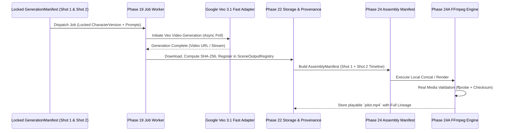

# AI Movie Studio — Recovery Blueprint

## 1. Project Objective and Overall Architecture

### 1.1 Objective
The **AI Movie Studio** is an enterprise-grade, provider-neutral production platform designed to guide AI filmmaking from creative development through shot planning, consistent character generation, physical media synthesis, timeline assembly/rendering, director review, and release governance.

Following an unrecoverable hard drive failure on the primary development workstation, the historical application source code, databases, workers, and rendered assets were completely lost. The repository at `https://github.com/strategysamuel/ai-movie-studio` was re-initialized at commit `75b73f1` containing only foundational repository metadata (`README.md` and `.gitignore`).

This blueprint defines the authoritative architectural specifications, boundary rules, non-negotiable invariants, and reconstruction guidelines necessary to rebuild the entire platform cleanly, deterministically, and with full provenance.

### 1.2 Top-Level Architectural Boundaries
The architecture maintains a strict decoupling between:
1. **Creative Development & Screenplay (Phase 27)**: Screenplay, dramatic beats, scene cards, and shot breakdown intentions.
2. **Character Identity Authority (Phase 20)**: Canonical character profiles, immutable CharacterVersions, reference asset fingerprints, and scene appearance assignments.
3. **Planning & Orchestration Authority (Phase 23)**: Production trees, shot dependency DAGs, shot planning, and schedule coordination.
4. **Execution Authority & Jobs (Phase 19 & Phase 21)**: Durable job queues, worker leases, idempotent retry governance, and execution strictly against immutable generation manifests (`GenerationManifest`). Dynamic resolution of "latest" versions at worker runtime is strictly prohibited.
5. **Provider Adapters & Asset Provenance (Phase 22)**: Cloud/remote generation adapters (e.g., Google Veo, Runway, OpenAI Sora, ComfyUI/cloud), local and remote storage abstractions, SHA-256 checksums, and the immutable `SceneOutputRegistry`.
6. **Assembly & Final Rendering Authority (Phase 24 & 24A)**: Exact shot-output selection, multi-track timeline assembly manifests, local FFmpeg real media rendering with atomic output swaps and integrity verification.
7. **Quality Control & Review Authority (Phase 25)**: Technical/visual evaluation, director review gates, and governed regeneration (which creates new lineage branches rather than overwriting past outputs).
8. **Release Governance Authority (Phase 26)**: Stage gates, immutable release manifests, release package bundles, and archival preservation.
9. **Operational Observability (Phase 28)**: Observational projections, cost telemetry, system metrics, bottleneck analysis, and operational event buses. Must remain strictly read-only/observational without hidden business-control side effects.

```mermaid
graph TD
    P27[Phase 27: Creative Development & Screenplay] --> P23[Phase 23: Production Planning & Orchestration]
    P20[Phase 20: Canonical Character Identity & Versions] --> P21[Phase 21: Immutable Generation Manifests]
    P23 --> P21
    P21 --> P19[Phase 19: Durable Worker Engine & Job Leases]
    P19 --> P22[Phase 22: Provider Adapters & Asset Provenance]
    P22 --> P25[Phase 25: Technical & Director Quality Evaluation]
    P25 -.->|Regeneration Request (New Lineage)| P21
    P22 --> P24[Phase 24 / 24A: Assembly Manifest & FFmpeg Render Engine]
    P24 --> P26[Phase 26: Movie Lifecycle & Release Governance]
    
    subgraph Observability
        P28[Phase 28: Observational Telemetry & Event Projections]
    end
    P19 -.-> P28
    P22 -.-> P28
    P24 -.-> P28
    P26 -.-> P28
```

---

## 2. Phase Authority Map

| Phase | Phase Name & Domain | Authority Scope | Critical Boundaries & Restrictions | Status |
| :--- | :--- | :--- | :--- | :--- |
| **Phases 1–18** | Foundational Infrastructure & Domain Core | Core data domain, configuration, foundational services, and initial project architecture. | Historical implementations are lost. Details must be reconstructed from validated records and cleanly tested, not assumed or hallucinated. | Historical Record (Needs Reconstruction) |
| **Phase 19** | Durable Background Jobs & Worker Execution | Job lifecycle state machine, lease management, worker heartbeats, idempotency keys, and retry backoff governance. | Workers must execute idempotently. A worker never mutates domain authority entities outside job results. | Historical Record (Needs Reconstruction) |
| **Phase 20** | Canonical Character Identity | Canonical Characters, immutable `CharacterVersion` records, visual reference assets (manual + AI), visual consistency fingerprints. | Character identity is strictly isolated from scene appearance. Version records are strictly immutable. | Historical Record (Needs Reconstruction) |
| **Phase 21** | Generation-Context Manifests & Lineage | Immutable `GenerationManifest` generation, exact pinned `CharacterVersionId`, locked prompts, seed, aspect ratio, camera directions. | Workers are forbidden from resolving "latest" version at runtime. Generation manifests cannot be mutated once locked. | Historical Record (Needs Reconstruction) |
| **Phase 22** | Provider-Neutral Execution & Storage Abstractions | Provider adapters (e.g. Veo, ComfyUI, etc.), cloud/local storage abstractions, SHA-256 validation, `SceneOutputRegistry` provenance. | Provider SDK details must remain strictly encapsulated inside provider adapters. Every output requires full lineage metadata. | Historical Record (Needs Reconstruction) |
| **Phase 23** | Movie Production Hierarchy & Orchestration | Movie -> Act -> Scene -> Shot hierarchy, shot dependencies, production DAG resolution, batch scheduling. | Planning authority only. Does not directly execute render binaries or external vendor APIs. | Historical Record (Needs Reconstruction) |
| **Phase 24** | Assembly Timelines & Manifests | Multi-track timeline assembly, exact `SceneOutput` selection, audio track binding, immutable `AssemblyManifest`. | Assembly authority only. Coordinates edit decision lists and timeline validation. | Historical Record (Needs Reconstruction) |
| **Phase 24A** | Local FFmpeg Media Rendering | Local FFmpeg process execution, real audio/video decoding validation, safe temporary file writing, atomic finalization. | Requires verified FFmpeg binaries. Validates container decodability, duration, frame rates, and SHA-256 checksums. | Historical Record (Needs Reconstruction) |
| **Phase 25** | Quality Evaluation & Director Review | Technical audio/video validation, visual consistency scoring, director review approvals/rejections, governed regeneration requests. | Quality evaluation never mutates canonical identity, existing manifests, or historic assets. Regeneration issues new lineage. | Historical Record (Needs Reconstruction) |
| **Phase 26** | Movie Lifecycle & Release Governance | Workflow gates (`DRAFT`, `IN_PRODUCTION`, `IN_ASSEMBLY`, `REVIEW`, `RELEASE_CANDIDATE`, `RELEASED`, `ARCHIVED`), immutable release manifests. | Sole authority for final movie release packages. `BLOCKED` is treated as a condition/flag, not a lifecycle state. | Historical Record (Needs Reconstruction) |
| **Phase 27** | Creative Development & Screenplay | Screenplay authoring, scene cards, dramatic beats, storyboard breakdown, production handoff. | Upstream creative authority. Handoff to Phase 23 freezes creative intent into planned shots. | Historical Record (Needs Reconstruction) |
| **Phase 28** | Operational Observability & Projections | Event bus listeners, operational projections, telemetry, bottleneck diagnostics, cloud cost tracking, alert rules, immutable snapshots. | Strictly observational. Forbidden from exerting control logic or acting as a hidden business authority. | Historical Record (Needs Reconstruction) |

---

## 3. Known Historical Decisions and Invariants

Every subsystem in the AI Movie Studio must adhere to the following fifteen non-negotiable architectural invariants:

1. **Character Identity vs. Scene Appearance**: Canonical character identity (visual traits, facial structure, reference sheets, color palettes) is permanently decoupled from scene-specific appearance (costume changes, battle damage, lighting, emotional expression).
2. **Immutable Locked Versions and Manifests**: Once created and locked, `CharacterVersion`, `GenerationManifest`, `AssemblyManifest`, and `ReleaseManifest` entities are strictly read-only.
3. **Traceable Asset Provenance**: Every generated file (video, image, audio, timeline render) must have an associated `SceneOutputRegistry` entry with SHA-256 checksum, provider metadata, model parameters, seed, and parent lineage.
4. **Exact Worker Manifest Execution**: Workers must receive and execute against the exact locked manifest payload. Workers are strictly forbidden from dynamically looking up the "current" or "latest" character version or prompt template.
5. **Non-Destructive Regeneration**: Regeneration of shots or scenes never overwrites historical execution logs or generated assets. Instead, it creates a new generation manifest, new job execution, and a new branch in the output lineage.
6. **Separation of Planning and Execution Authorities**: Planning Authority (Phase 23/27) creates structures and dependencies; Execution Authority (Phase 19/21/22) executes tasks. Neither encroaches on the other.
7. **Non-Mutating Quality Control**: Quality control inspections and director reviews (Phase 25) evaluate assets and attach approval/rejection verdicts with diagnostic criteria. QC never modifies identity models, manifests, or rendered media files.
8. **Phase 24 / 24A as Sole Assembly and Rendering Authority**: All final timeline cuts, multi-track audio multiplexing, and media rendering must pass through Phase 24's manifest builder and Phase 24A's validated FFmpeg render engine.
9. **Phase 26 as Sole Release Authority**: Final distribution bundles, release candidate validation, and movie-level sign-offs are exclusively owned by Phase 26.
10. **Phase 28 Observational Rule**: Telemetry, operational metrics, bottleneck detectors, and event projections must never gate business logic or write state into domain entities.
11. **`BLOCKED` is a Condition, Not a Lifecycle State**: The project, act, scene, or shot lifecycle states follow definite progression stages. `BLOCKED` represents an operational obstruction or gate failure flag, not a lifecycle stage.
12. **Provider Isolation**: Provider-specific SDKs (Google GenAI / Veo, OpenAI, Runway, ComfyUI, etc.) must reside exclusively within provider adapter packages behind standard interfaces. Core business logic never imports vendor SDKs directly.
13. **Hybrid Generation Architecture (Cloud/External Execution)**: Because the local development PC has limited GPU compute capability, heavy generative workloads (video generation, high-res diffusion, voice synthesis) must execute via cloud or remote provider adapters, while local execution is reserved for orchestration, lightweight tasks, and FFmpeg assembly.
14. **Dual Character Reference Support**: Reference assets must support both AI-generated reference turnaround sheets and manual/custom uploaded images with equal fidelity and fingerprinting.
15. **First-Class Character Consistency**: Character visual and semantic consistency across shots, scenes, and lighting environments is a primary objective enforced through consistency fingerprints and strict manifest lineage.

---

## 4. Phase 24 & Phase 24A Restoration Requirements

Assembly and rendering represent critical architectural milestones connecting generated video fragments into a coherent, playable movie.

### 4.1 Phase 24: Assembly Authority
- **Timeline Specification**: Support multi-track sequencing (Video Track 1..N, Dialogue/Voiceover, Music, Sound Effects).
- **Exact Selection Binding**: Each timeline clip must bind to an exact `scene_output_id` from the `SceneOutputRegistry`. Pointers to mutable "latest approved" references are prohibited.
- **Assembly Manifest**: An immutable JSON document encapsulating:
  - Timeline tracks, clips, start times, durations, transition parameters.
  - Resolved source media local paths or storage URIs.
  - Expected output resolution, pixel format, frame rate (e.g. 24 fps), audio sample rate (e.g. 48 kHz).
  - Parent manifests and shot linkage.

### 4.2 Phase 24A: Local FFmpeg Render Engine
- **System FFmpeg Discovery & Verification**: Verification of installed FFmpeg/FFprobe binaries on Windows (`ffmpeg.exe`, `ffprobe.exe`), validating minimum version requirements and codec support (H.264 / AAC).
- **Safe Staging and Temporary Outputs**: Rendering must execute into isolated temporary files (e.g., `temp_render_<uuid>.mp4`). Direct in-place rendering to the final target filename is strictly forbidden.
- **Atomic Promotion**: The temporary output file is verified before being atomically renamed/moved into the permanent output destination.
- **Real Media Validation**:
  - `ffprobe` execution to verify container integrity, video stream presence, codec compliance, exact audio/video duration, and absence of corrupted frames.
  - Computing and recording the SHA-256 cryptographic checksum of the resulting media file into the `SceneOutputRegistry`.

---

## 5. Physical Pilot 01 Acceptance Criteria

> [!WARNING]
> **Historical Target Notice**: Physical Pilot 01 was specified prior to the disk failure, but its physical execution was never performed or verified due to pending local API keys. It remains a historical blueprint target for post-reconstruction validation.

### 5.1 Pilot Objective
Validate the entire end-to-end pipeline using real Google Veo 3.1 Fast cloud generation for two consecutive shots featuring the exact same locked character, assembled locally via FFmpeg into a single playable MP4 video.

### 5.2 Pilot Pipeline Flow


### 5.3 Acceptance Checklist for Physical Pilot 01
1. **Canonical Character Version**: A single `CharacterVersion` locked with visual reference context and consistent prompt descriptors.
2. **Generation Manifests**: Two distinct, immutable `GenerationManifest` records (Shot 01 and Shot 02) referencing the exact same `CharacterVersionId`.
3. **Real Cloud Execution**: Asynchronous dispatch to the Google Veo 3.1 Fast endpoint using official provider credentials, polling until job completion without simulated bypasses.
4. **Media Ingestion & Decodability**: Successful download of generated video files to managed storage, validation via `ffprobe` confirming valid H.264 video streams.
5. **Lineage & Provenance Registration**: Ingestion of both raw shot outputs into `SceneOutputRegistry` with SHA-256 hashes, generation parameters, latency, and model metadata.
6. **Assembly Manifest Generation**: Phase 24 compilation of a 2-shot chronological timeline referencing the exact output IDs.
7. **FFmpeg Render & Integrity Verification**: Phase 24A execution of local FFmpeg rendering to compile `pilot.mp4`, validating container readability, video continuity, and calculating the final checksum.
8. **Verification Report**: Generation of an audit trail showing the uninterrupted chain of custody from character creation to final playable media.

---

## 6. Distinction Between Historical Evidence and Current Implementation

To ensure total transparency and avoid false claims:

| Component / Layer | Historical Documented State | Current Repository State (`75b73f1`) | Reconstruction Obligation |
| :--- | :--- | :--- | :--- |
| **Git History & Repo** | Active development repository. | Re-initialized on GitHub; commit `75b73f1` with initial README & .gitignore. | Preserve repo, history, and remotes. Track reconstruction commits cleanly. |
| **Phases 1–18 (Domain & DB)** | Implemented data models, schemas, and configurations. | **Lost in disk failure.** Not present in repo. | Must be reconstructed from validated architectural specifications with clean tests. |
| **Phase 19 (Worker & Jobs)** | Durable background worker designs, leases, retry logic. | **Lost in disk failure.** Not present in repo. | Reconstruct job schemas, lease management, worker loops, and idempotency guarantees. |
| **Phase 20 (Character Identity)** | Character identity, versions, reference assets, consistency fingerprints. | **Lost in disk failure.** Not present in repo. | Implement clean models for Character, CharacterVersion, and asset fingerprinting. |
| **Phase 21 (Manifests)** | GenerationManifest generator and version locking rules. | **Lost in disk failure.** Not present in repo. | Implement immutable manifest generation and strict worker immutability enforcement. |
| **Phase 22 (Providers & Registry)**| Storage abstraction, SceneOutputRegistry, provider interface. | **Lost in disk failure.** Not present in repo. | Implement storage providers, output registry, checksum calculators, and adapter interfaces. |
| **Phase 23 (Orchestration)** | Movie hierarchy, shot DAG, production planning. | **Lost in disk failure.** Not present in repo. | Implement production models (Movie, Act, Scene, Shot) and dependency resolvers. |
| **Phase 24 & 24A (Assembly/FFmpeg)**| Multi-track timeline manifest and local FFmpeg engine. | **Lost in disk failure.** Not present in repo. | Implement timeline builder, FFmpeg wrapper, atomic promotion, and ffprobe validation. |
| **Phase 25 (QC & Review)** | Review states, quality criteria, non-destructive regeneration. | **Lost in disk failure.** Not present in repo. | Implement review entities, scoring validators, and regeneration lineage branching. |
| **Phase 26 (Release Governance)** | Movie lifecycle state machine, release manifest compiler. | **Lost in disk failure.** Not present in repo. | Implement lifecycle gatekeeper, release manifests, and distribution bundlers. |
| **Phase 27 (Creative Screenplay)**| Screenplay parser, beats, scene card breakdowns. | **Lost in disk failure.** Not present in repo. | Implement creative domain models and planning handoff logic. |
| **Phase 28 (Observability)** | Telemetry collectors, projection listeners, diagnostic rules. | **Lost in disk failure.** Not present in repo. | Implement event bus contracts, read-only projection stores, and metric aggregators. |
| **Physical Pilot 01** | Specified and planned; awaited local API key. | **Unexecuted.** | Do not execute until Phase 19–24A are rebuilt, verified, and explicitly authorized. |
